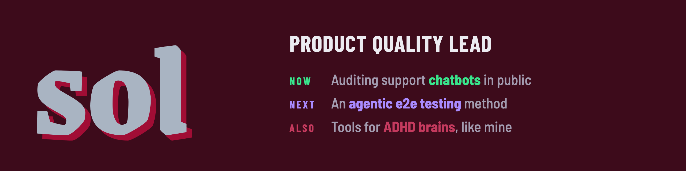

**Agentic testing**\
[agentic-e2e-method](https://github.com/missyeahhh/agentic-e2e-method): an agent proposes, a human approves, Playwright runs, a versioned judge decides. No component validates its own output.\
[rag-bouncer](https://github.com/missyeahhh/rag-bouncer): a support bot for Ghost's docs with two bouncers, a Ragas eval gate in CI and a guard that lets self-healing fix locators, never assertions.

**In public**\
[Customer support chatbot observatory](https://github.com/missyeahhh/chatbot-observatory): audits of support bots against versioned rubrics for accessibility, deceptive patterns and operational truthfulness.

**Also**\
[ADHD Hyperfocus Graph](https://github.com/missyeahhh/adhd-hyperfocus-graph): an Obsidian plugin that makes the graph readable for ADHD and dyslexic brains.

[LinkedIn](https://www.linkedin.com/in/soldr)
